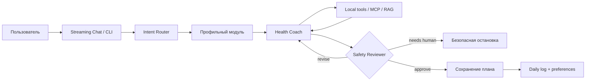

<div align="center">

# NutriOS Agent

**Локальная wellness OS с intent routing, RAG, MCP-интеграциями и обязательной safety-проверкой каждого ответа.**

[](https://nextjs.org/)
[](https://react.dev/)
[](https://www.typescriptlang.org/)
[](https://modelcontextprotocol.io/)
[](https://supabase.com/)

</div>

NutriOS Agent превращает свободный запрос пользователя в персональный wellness-план. Система определяет намерение, выбирает профильный модуль и разрешённые инструменты, извлекает знания из RAG и проводит независимый safety review. Финальный план, дневник и подтверждённые предпочтения сохраняются harness-ом только после одобрения.

> [!IMPORTANT]
> NutriOS Agent не ставит диагнозы и не заменяет врача. Запросы о боли, лечении, лекарствах и других медицинских темах останавливаются до сохранения плана и направляются к профильному специалисту.

## Возможности

- **Streaming chat UI** — этапы выполнения, выбранный модуль, tool calls, safety review и итоговый ответ появляются в едином timeline.
- **Intent routing** — один быстрый LLM-вызов выбирает профильную конфигурацию; низкая уверенность включает безопасный `general`-режим.
- **Восемь wellness-модулей** — дневной план, питание, рецепты, тренировки, восстановление, привычки, покупки и поиск знаний.
- **Обязательный Safety Reviewer** — единый tool-free reviewer проверяет каждый модуль; автоматическое сохранение финального плана и OS-памяти выполняется после `approve`.
- **RAG вместо выдуманных деталей** — правила, рецепты и шаблоны извлекаются из Supabase pgvector; embeddings вычисляются локально через Ollama.
- **MCP-интеграции** — локальная markdown-память, ограниченный filesystem, погода Open-Meteo и опциональное сохранение в Notion.
- **Наблюдаемость** — завершившийся run пытается сохранить JSON-trace с раундами, verdict, score, tool calls, retrievals и версиями prompts; ранние ошибки могут завершиться без trace.
- **Harness-level memory** — дневник и подтверждённые предпочтения обновляются orchestration-кодом только после safety approve.

## Как это работает



Модуль — это специализированный prompt и allowlist инструментов поверх одного Health Coach, а не отдельный агент. Такая схема сохраняет единый execution loop и одинаковую safety-границу для всех типов задач.

| Модуль | Назначение |
| --- | --- |
| `dailyPlan` | Целостный план дня: питание, активность и восстановление |
| `nutrition` | Рацион, структура приёмов пищи и пищевые привычки |
| `recipes` | Подбор рецептов и подготовка списка покупок |
| `training` | Тренировочные планы с учётом уровня и инвентаря |
| `recovery` | Сон, нагрузка, стресс и немедицинское восстановление |
| `habits` | Чтение и отметка локальных привычек |
| `shoppingList` | Практичный список покупок по плану или меню |
| `knowledge` | Ответы на основе локальной базы знаний |

## Технологии

| Слой | Используется |
| --- | --- |
| Интерфейс | Next.js App Router, React, Tailwind CSS, shadcn-style primitives |
| Agent runtime | OpenAI Agents SDK с OpenAI-compatible DeepSeek API |
| Оркестрация | TypeScript harness, review loop, versioned prompts, event stream |
| Инструменты | MCP stdio servers и локальные function tools |
| RAG | Supabase Postgres, pgvector, Ollama, `bge-m3` |
| Валидация | Zod schemas и structured reviewer output |
| Наблюдаемость | JSON traces, replay, score и метаданные запуска |

## Быстрый старт

### Требования

- Node.js `>= 20.9.0`;
- npm;
- API-ключ DeepSeek или другого совместимого endpoint;
- Git.

Для полноценных профильных рекомендаций также нужны Supabase и локальный [Ollama](https://ollama.com/). Notion подключается опционально.

> [!NOTE]
> Интерфейс и CLI запускаются без RAG, но модули питания, рецептов, тренировок, восстановления, дневного плана и поиска знаний не смогут выполнить обязательный `searchKnowledge`. Для полноценной демонстрации настройте раздел «Подключение RAG» до первого запроса.

### 1. Клонируйте репозиторий

```bash
git clone https://github.com/KatnikovAA/NutriOS-Agent.git
cd NutriOS-Agent
npm install
```

### 2. Настройте окружение

Создайте `.env` в корне проекта:

```dotenv
# Обязательно
DEEPSEEK_API_KEY=<your-deepseek-api-key>

# Опционально: OpenAI-compatible endpoint и модели
DEEPSEEK_BASE_URL=https://api.deepseek.com
DEEPSEEK_MODEL=deepseek-v4-flash
DEEPSEEK_ROUTER_MODEL=deepseek-chat
```

> [!CAUTION]
> Никогда не коммитьте `.env`. Файл уже добавлен в `.gitignore`; все секреты используются только server-side.

### 3. Подготовьте локальную память

Создайте каталог `data/` и три markdown-файла:

| Файл | Содержимое |
| --- | --- |
| `data/profile.md` | Цели, ограничения, предпочтения, активность, сон и доступный инвентарь |
| `data/log.md` | Дневник питания, энергии, сна, активности и восстановления |
| `data/recipes.md` | Любимые рецепты и удобные варианты блюд |

`output.md`, `preferences.md` и `habits.md` создаются и обновляются во время работы. Личные `data/*.md` не отслеживаются Git.

### 4. Запустите приложение

```bash
npm run dev
```

Откройте [http://localhost:3000](http://localhost:3000) и отправьте wellness-запрос, например: `Составь план на завтра с учётом моего профиля`.

Для production-сборки:

```bash
npm run build
npm run start
```

## Подключение RAG

RAG отделяет общую базу знаний от персональной памяти. В Supabase хранятся только embeddings материалов из `knowledge/`; `data/profile.md` и `data/log.md` хранятся локально и не участвуют в ingest.

> [!IMPORTANT]
> Локальное хранение не означает полностью локальный inference: когда агент вызывает MCP-tools профиля или дневника, релевантное содержимое передаётся настроенному LLM-провайдеру для формирования ответа. Не добавляйте в эти файлы данные, которые не готовы отправлять выбранному провайдеру.

1. Создайте проект Supabase.
2. Выполните в SQL Editor файлы `docs/001_create_knowledge_chunks_table.sql` и `docs/002_change_knowledge_embedding_to_1024.sql` по порядку.
3. Установите Ollama и загрузите embedding-модель:

   ```bash
   ollama pull bge-m3
   ```

4. Добавьте настройки в `.env`:

   ```dotenv
   SUPABASE_URL=https://<project-ref>.supabase.co
   SUPABASE_SERVICE_ROLE_KEY=<your-server-side-service-role-key>
   EMBEDDING_BASE_URL=http://127.0.0.1:11434/v1
   EMBEDDING_API_KEY=ollama
   EMBEDDING_MODEL=bge-m3
   EMBEDDING_DIMENSIONS=1024
   ```

5. Загрузите базу знаний:

   ```bash
   npm run ingest
   ```

> [!WARNING]
> `SUPABASE_SERVICE_ROLE_KEY` обладает повышенными правами. Не используйте префикс `NEXT_PUBLIC_`, не передавайте ключ в браузер и ограничьте его использованием только на сервере.

Файлы `docs/003_verify_knowledge_chunks.sql` и `docs/004_verify_knowledge_rpc_logs.sql` помогают проверить загруженные chunks и вызовы поиска.

## MCP-интеграции

Серверы описаны декларативно в `src/mcp/servers.config.ts` и запускаются harness-ом как отдельные stdio-процессы.

| Сервер | Возможности | Настройка |
| --- | --- | --- |
| `markdown-health` | Профиль, дневник, рецепты, preferences, habits, финальный план | Работает локально |
| `filesystem` | Доступ только к `data/` и `plans/` | Работает локально |
| `weather` | Геокодинг и прогноз Open-Meteo | Ключ не нужен |
| `notion` | Сохранение одобренного плана в Notion | Требует `NOTION_TOKEN` |

Чтобы включить Notion:

1. Создайте internal integration в Notion.
2. Создайте страницу `Wellness` и предоставьте integration доступ только к ней.
3. Добавьте токен в `.env`:

   ```dotenv
   NOTION_TOKEN=<your-notion-integration-token>
   ```

4. Перезапустите приложение. После approve в интерфейсе появится возможность сохранить готовый markdown-план в Notion без повторного запуска модели.

Проверить доступные MCP tools и resources:

```bash
npm run mcp:inspect
```

## CLI

Тот же OS-flow доступен без браузера:

```bash
npm run cli -- "составь план питания на завтра"
npm run cli -- "подбери тренировку с учётом погоды"
npm run cli -- "отметь привычку: выпил воду утром"
```

Медицинский запрос завершится безопасной остановкой и не будет записан как одобренный план.

## Локальные данные и traces

| Путь | Назначение | Git |
| --- | --- | --- |
| `data/*.md` | Профиль, дневник, память, привычки и последний план | Игнорируется |
| `plans/*.md` | Дополнительные сохранённые планы | Игнорируется |
| `runs/run-*.json` | Локальные traces запусков | Игнорируется |
| `knowledge/*.md` | Общая база знаний для ingest | Отслеживается |
| `prompts/*.md` | Версионированные системные prompts | Отслеживается |

Повторить задачу из сохранённого trace:

```bash
npm run replay runs/run-<timestamp>.json
```

## Структура проекта

```text
app/                  Next.js UI и API routes
components/           UI-примитивы и markdown rendering
src/agents/           Health Coach и tool-free Safety Reviewer
src/os/               Intent router, модули и post-approve memory
src/harness/          Execution loop, events, review, score и traces
src/mcp/              MCP server и декларативный конфиг интеграций
src/rag/              Embeddings и поиск по Supabase pgvector
src/skills/           Локальные function tools
prompts/              Версионированные и модульные prompts
knowledge/            Исходная база знаний
scripts/              Ingest, replay и инспекция MCP
docs/                 SQL-схемы и техническая документация
```

## Основные команды

| Команда | Назначение |
| --- | --- |
| `npm run dev` | Запустить локальный Next.js-сервер |
| `npm run build` | Проверить типы и собрать production bundle |
| `npm run start` | Запустить production-сборку |
| `npm run cli -- "..."` | Выполнить задачу через CLI |
| `npm run ingest` | Переиндексировать базу знаний в Supabase |
| `npm run mcp:inspect` | Показать MCP tools и resources |
| `npm run replay runs/run-<timestamp>.json` | Повторить задачу из trace |

## Safety и границы доступа

- Safety Reviewer не имеет tools и не выполняет побочных эффектов.
- Модуль меняет только prompt и allowlist инструментов Health Coach.
- `save_health_plan`, `append_daily_log` и `update_preferences` скрыты от модели и вызываются harness-ом после `approve`.
- Действия профильных tools, например явная отметка привычки, выполняются во время agent run и отражаются в `toolCalls`; post-approve gate относится к автоматическому сохранению плана и OS-памяти.
- Filesystem MCP ограничен каталогами `data/` и `plans/`.
- Notion integration ограничивается правами, выданными конкретной странице `Wellness`.
- Медицинская граница работает fail-closed: явный медицинский запрос останавливается даже при невалидном structured output reviewer-а.
